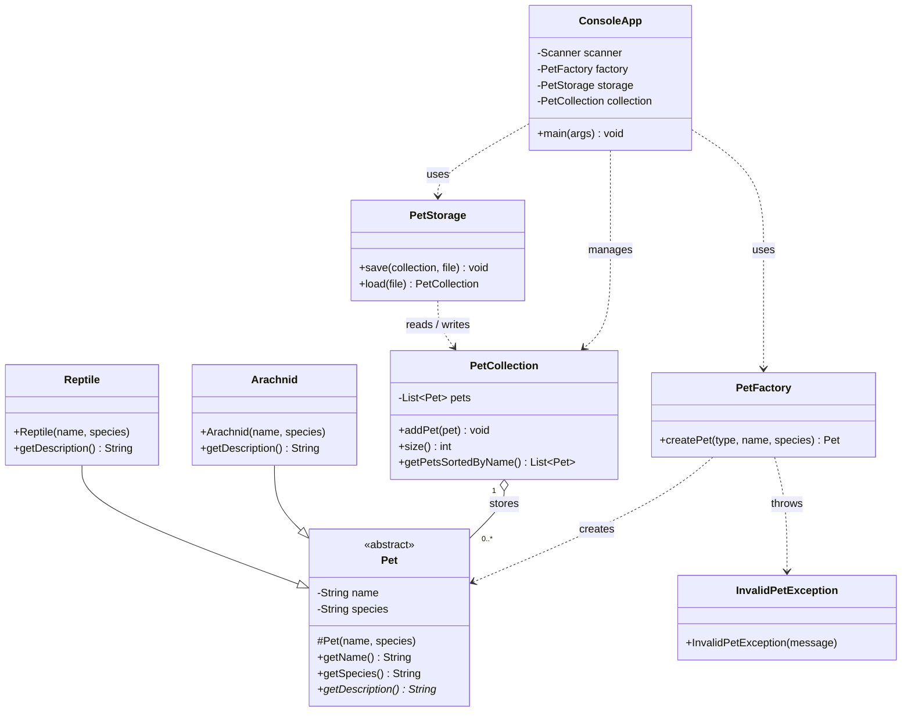

# UML class diagram

The following class diagram is rendered directly by GitHub. Its Mermaid source is editable.

Visibility: `-` private, `#` protected, `+` public. The hollow diamond shows aggregation: one collection stores zero or more pets. Hollow triangles indicate inheritance, and dashed arrows show dependencies.

## Factory pattern participants

- **Factory:** `PetFactory`
- **Common product:** `Pet`
- **Concrete products:** `Reptile` and `Arachnid`
- **Client:** `ConsoleApp`

`ConsoleApp` asks the factory for a `Pet` instead of directly constructing a concrete subtype. Runtime polymorphism occurs when a `Pet` reference calls `getDescription()`.
